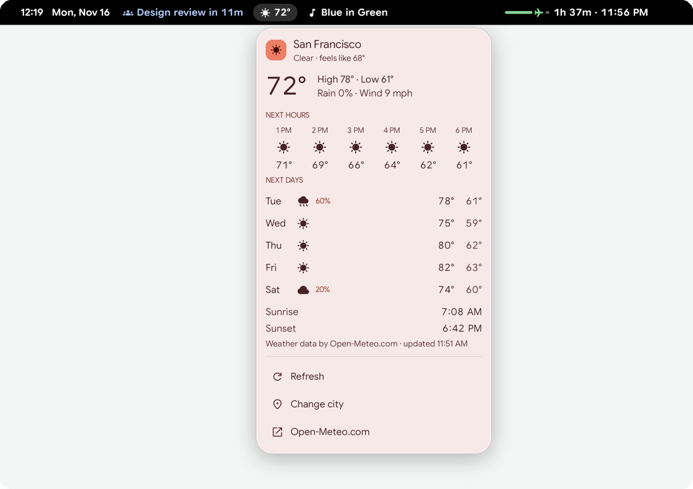
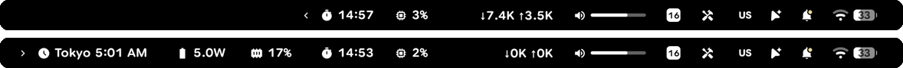
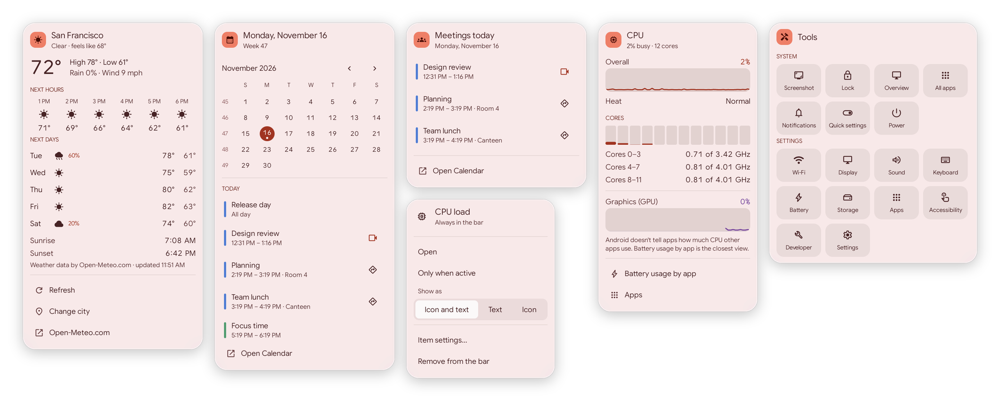
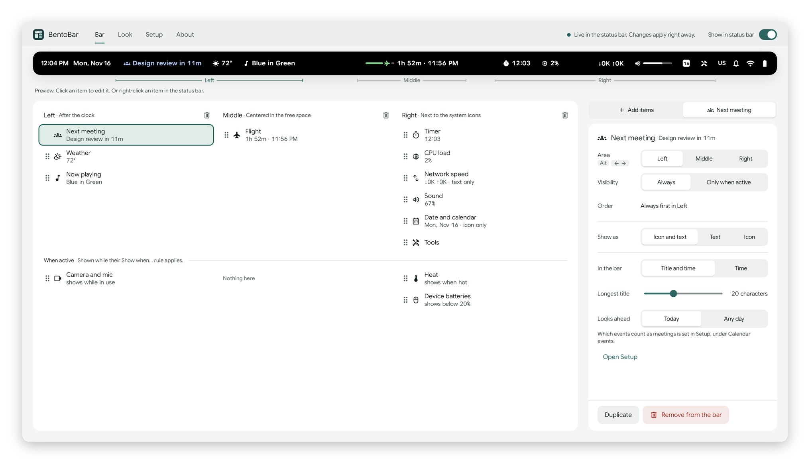
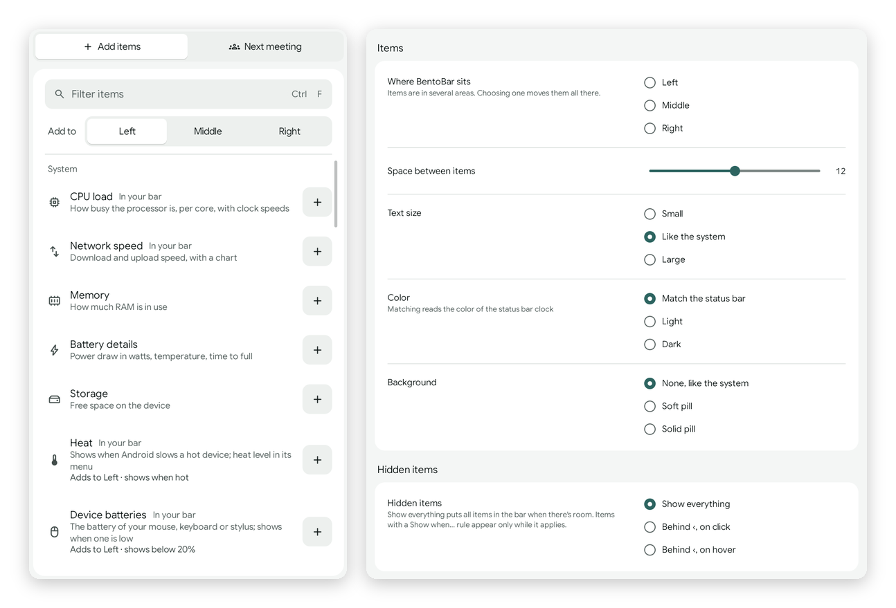

<p align="center">
  
</p>

<h1 align="center">BentoBar</h1>

<p align="center">
  <b>Add, hide and organise items in your Googlebook's status bar.</b><br>
  Your own items next to the system's icons, as an ordinary Android app: no root, no adb.
</p>

<p align="center">
  <a href="../../releases/latest/download/BentoBar.apk"><b>⬇ Download BentoBar.apk</b></a>
  &nbsp;·&nbsp; <a href="#install">Install</a>
  &nbsp;·&nbsp; <a href="#privacy">Privacy</a>
  &nbsp;·&nbsp; <a href="CHANGELOG.md">What's new</a>
</p>

<p align="center">
  
  
  
  
</p>

<p align="center"><sub>Made by Meridian11 LLC, proudly developed on a Googlebook.
Not affiliated with or endorsed by any employer (<a href="#about-this-project">more</a>).</sub></p>

<p align="center">
  
</p>

## What it does

BentoBar puts **your own items** into the empty part of the status bar, right next to the
system's icons, in the same font and colour. Items you don't need all the time can show only while
they have something to say, or wait **behind the ‹ button**: one click reveals them, another folds
them away. Like a bento box: everything in its compartment, and the whole thing neat.

<p align="center">
  
  <br><sub>With hidden items behind ‹ (a Look setting; the default shows everything that fits), folded (top) and revealed (bottom): a world clock, battery and memory slide in next to the running timer.</sub>
</p>

- **Show when active:** a hidden item can pop out on its own while it has something to say, such
  as a running timer, a meeting about to start or a busy CPU, and disappear again after. Its
  settings say the rule in words ("Show when CPU load is above 80%") and let you set the number.
- **Drag to reorder** in settings, within a section or into another one.
- **Click any item** for its menu: charts, details and actions.
- **Right-click an item** to hide it, move it or change how it looks.
- **Scroll** over the sound item to change the volume, or over the timer to add minutes. The sound
  item can also draw a **volume slider** right in the bar.
- **Quick Settings tiles** switch BentoBar off (for presenting), keep the screen awake, or start a
  25-minute timer.
- **Live Update chip:** when BentoBar is off, a running timer still shows as Android's own status
  bar chip.

BentoBar stays out of the way. It moves aside when the system's own icons or chips change, and
hides when an app goes full screen or the screen locks.

## Items

| Item | In the bar | In its menu |
|---|---|---|
| **CPU load** | busy %; can also pop out when the device runs hot | chart, per-core load, clock speeds, GPU load |
| **Network speed** | ↓ download ↑ upload | chart, totals since start-up, connection, addresses, gateway and DNS |
| **Memory** | RAM in use | used, available, chart |
| **Battery details** | watts, %, temperature or time to full | power in or out, voltage, current, health, cycles, thermal state |
| **Storage** | free space | used and free, shortcuts to clean up |
| **Date and calendar** | the date, in your format | a month view, and the day's events (meetings and all-day ones too) with **Join** and **Directions**; tasks that apps like Todoist sync to your calendar are left out, here and in Next meeting, and so are canceled and declined events |
| **Next meeting** | title and countdown (or the time alone), until 3 a.m. tomorrow or, with **Looks ahead: Any day**, your next meeting on a later day; a meeting that starts during a long one shows from your "Show when" minutes before it; just the icon when there are no more meetings | today's meetings with **Join** and **Directions** |
| **Clock** | a second clock: seconds, 24-hour or another city | world clocks: add cities in the menu, and **Plan a time**, a slider that shows any time of day in every city (copy the line, or start a calendar event there) |
| **Timer** | countdown, stopwatch or Pomodoro | start, pause, +1 min, stop |
| **Countdown** | days and hours to a date | exact time left |
| **Keep awake** | coffee cup: click to switch | 15 min to "until I turn it off" |
| **Sound** | volume, as a number or as a slider you click or drag | volume slider, play/pause/next |
| **Now playing** | the title while something plays | artwork, position, previous, play and next, other players. The title needs notification access (optional); without it the item still shows that something plays and controls it |
| **Device batteries** | the lowest of your mouse, keyboard, stylus or controller, when it's low | every device that reports a battery |
| **External displays** | connected monitor resolution & refresh rate (`4K 60Hz`), when plugged in | every display's resolution, refresh rate and HDR status, plus **Keep awake while connected** |
| **Heat** | a word when Android slows a hot device | heat level, battery temperature |
| **Weather** *(online)* | conditions and temperature of a city you pick or of where you are; rain or snow that is coming; optionally a word for the sky ("Partly cloudy", "Windy") | the next hours and days, sunrise and sunset. From [Open-Meteo](https://open-meteo.com) |
| **Air quality & UV** *(online)* | US or European AQI and/or UV index for your city or location; pops out when AQI or UV is high | AQI band, PM2.5, PM10, Ozone ($\text{O}_3$), current and max daily UV. From [Open-Meteo](https://open-meteo.com) |
| **Flight** *(online)* | a line with the plane where the flight is, a countdown to departure with the gate, then to landing, and delays | times at both airports, terminal, gate, baggage belt; a choice where a number flies more than once a day. From AirLabs, with a free key of your own |
| **US stocks** *(online)* | US stocks you pick, one at a time (`AAPL 227.52 ▲1.2%`) for 3 seconds to a minute each, as you choose; can pop out on a big move | each stock's price, day change and range, and the market's hours. From [Finnhub](https://finnhub.io), with a free key of your own |
| **Exchange rates** *(online)* | currency pairs you follow (`EUR/USD 1.0942`), rotating in the bar; can pop out on a big daily move | rate and daily % change for up to 6 pairs, plus an inline currency converter. From the European Central Bank via [Frankfurter](https://frankfurter.dev) (no key needed) |
| **Live activity** | the one thing happening now: a running timer, the meeting about to start, a flight, what plays; can show only while something is | everything happening now, and which of them it follows |
| **Camera and mic** | shows while an app uses the camera or the microphone, with the time it has | which of the two is in use and for how long, a button that mutes the microphone for every app, Android's privacy settings |
| **Mirror** | a camera glyph | you, from the camera: a look before a call. The camera runs only while the popup is open |
| **Prompter** | a notes glyph | your notes moving up under the camera, to read while you speak; play, pause and a speed. The popup stays open while you use another window |
| **Notification icons** | other apps' notifications as icons, one per app | the list, to open, dismiss or clear |
| **Focus** | the time left of a Do Not Disturb session you start from the item | the length, a session with no end, End now |
| **Brightness** | the screen's brightness, with a slider in the bar | the slider, automatic brightness, display settings |
| **Keyboard light** | the keyboard's backlight, with a slider in the bar | Give back to the system |
| **Headphones and output** | where sound plays: headphones, USB, a display or the speaker | the output in use, the media volume, sound and Bluetooth settings |
| **Connection** | says when you're offline, need to sign in, have no internet, use a VPN or a metered network | the link, internet, VPN and metered, network settings |
| **Screen time** | how long the screen was on today | the apps longest in front today |
| **Day progress** | how much of the day is gone, or of the workday, the week, the month or the year | from when to when, and how far along |
| **Sunset** | the time until sunset or sunrise, around the main city of your time zone | sunrise, sunset and the day's length |
| **Break reminder** | the time until your next break, counted while the screen is on | how long you worked, the next break, I took one |
| **Tools** | toolbox | screenshot, lock, overview, all apps, power, settings shortcuts |
| **Shortcut** | one action, as its icon, its name or both (📷 Screenshot) | none: a click does it. Screenshot, Report a bug (the Googlebook's Feedback app), lock, overview, all apps, notifications, Quick settings |
| **App folder** / **App shortcut** | your apps | a grid of apps / one click to open |
| **Text or emoji**, **Spacer** | anything you like | optional link |

<p align="center">
  
</p>

## Settings

A live preview of your bar at the top; below it, your items (**in the bar** and, under a line, the ones
that wait behind ‹ or for their rule; drag a row to move it) with the items you can add or the selected
item's options beside them. Remove takes an item out for good (the red button in its options, Delete, or a drag
onto the trash that comes up under the list); Add items has every type to add again. With items in several areas,
each area's head has a trash that removes the area and what is in it. What a change says afterwards, with Undo,
stays three seconds; Ctrl+Z takes the change back after that too, until your next change or until you close the
settings window.
Changes apply to the status bar right away.

<p align="center">
  
</p>

<p align="center">
  
  <br><sub>Adding items, and choosing where BentoBar sits and how it looks.</sub>
</p>

### Which events are meetings

Next meeting, the Live Update chip and Live activity count the same events as meetings: timed events on a
calendar you can change, with someone else invited, or with only you and a call link. A colleague's meeting
on a calendar shared with you is not yours unless you are invited, a booked room is not someone else, and
canceled and declined events show nowhere. One meeting on two of your calendars counts once, as its copy on
your own calendar does: declined there, it doesn't count from a shared calendar either.
**Setup › Calendar events** changes that for this device:

- **Calendars**: untick one and its events never count (they still show in the month view).
- **Events with only you**: never count, count with a call link (the default), or always count.
- **Invitations you haven't answered**: on by default.
- **Events marked as free**: off by default.
- **Leave out titles with**: words or phrases; "Hold" leaves out "Hold: desk" and "On hold", not "Shareholders".
  Up to 20, each of up to 80 characters.

These choices stay on the device: they are no part of your layout, so Copy settings, a backup and a new
device don't carry them. A meeting you make on a shared calendar without inviting yourself is not counted
as yours (the calendar doesn't say who made it); add yourself as a guest.

## Install

BentoBar is made for Googlebooks (Googlebook OS, Android 17). Other Android 14+ devices with a
status bar may work, but haven't been tested.

1. On your Googlebook, download
   **[BentoBar.apk](../../releases/latest/download/BentoBar.apk)** from the latest release.
2. Open it from Chrome's downloads or the Files app. If Android asks, allow Chrome (or Files) to
   install apps, then tap **Install**. Google Play Protect may then say *"App blocked to protect
   your device"* because it hasn't seen an app from this developer before: tap **More details** ›
   **Install anyway**.
3. Open **BentoBar**. It says what its accessibility service does and asks whether you agree:
   **Agree** opens Android's Accessibility settings. (Later, the same is under **Setup** › **Turn on**.)
4. Because BentoBar came from a download, Android guards this switch the first time:
   1. Open **BentoBar** and tap the switch. Android says *"Restricted setting"*. Tap **OK**.
   2. Back in BentoBar, open **Setup** and tap **App info**, then **⋮** (top right) › **Allow restricted
      settings**, and confirm with your PIN.
   3. Return to Accessibility › **BentoBar** and turn it on.
5. Optional: in **Setup**, allow notifications (timer alerts, the Live Update chip) and calendar
   access (Next meeting, events in the month view). **Setup › Calendar events** then says which events
   count as meetings (see [Which events are meetings](#which-events-are-meetings)).

About a day later, Android shows *"Review app with full device access"*. That's a standard check
for every app that uses an accessibility service. Keep BentoBar if you're happy with what it does
(below).

To update, install a newer `BentoBar.apk` over the old one; your layout stays.

<a id="privacy"></a>
## Privacy: why an accessibility service, and what BentoBar does with it

Android lets an app draw on top of the status bar only through an accessibility service, so
Android warns that BentoBar can "view and control your screen". Here is everything BentoBar does
with that access:

- It listens only for **windows appearing, going or moving**, not their content, so it can hide
  for full-screen apps and shades.
- It reads the **status bar's layout**, to find free space, and **where other windows are**, never what is
  in them, to hide for full-screen apps and panels and to keep your items matching the status bar.
- It copies the **colour of the status bar clock**, from a picture of the status bar's own window
  (not your screen), so your items match.
- It runs **system actions** (screenshot, lock, overview, all apps, notifications, Quick Settings,
  power) when you pick them in the Tools menu or click a Shortcut item.

BentoBar never reads what is in another app's window and doesn't watch your keyboard, mouse or touches.

**BentoBar goes online for five items only, and only after you set them up** on this device:

- **Weather** sends [Open-Meteo](https://open-meteo.com) the city you search for, and for the forecast
  the coordinates of the city you pick, rounded to about a kilometre: about every 30 minutes while the
  bar is on screen, and when you open its menu or press Refresh. Open-Meteo sees your IP address, as
  any website does. With **My location** instead of a city, BentoBar asks Android for the device's
  approximate location (never the precise one) while that item is in the bar or waits in Hidden to show for
  rain or snow, or while BentoBar's settings window is open: every 30 minutes once it knows, and when
  Android doesn't, again after 1, 2, 5 and 15 minutes, then every 30. It sends
  Open-Meteo that location rounded to about 10 km. BentoBar asks only for Android's "while using the
  app" permission, not for background location. Where you are, and its forecast, are kept
  in memory only: never on the device, in your layout or in its backup.
- **Air quality & UV** sends Open-Meteo what Weather does (the city you search for, then the city's
  coordinates or, with My location, where the device is, rounded in the same way): about every 30
  minutes while the bar is on screen, and when you open its menu or press Refresh. Its readings are
  kept in memory only. Weather's switch in Setup › Online services covers it too.
- **Exchange rates** asks [Frankfurter](https://frankfurter.dev) for the European Central Bank's
  reference table of currencies, about once an hour while the bar is on screen (a failed try is repeated sooner), and when you open
  its menu or press Refresh. No key is needed, and the pairs you follow and the converter's amounts are
  worked out on the device. Frankfurter sees your IP address, as any website does.
- **Flight** sends [AirLabs](https://airlabs.co) the flight number and your own AirLabs key: when you
  track a flight, when you press Refresh, and while it follows the flight (about every 3 hours, then
  every 30 minutes or sooner from 3 hours before departure until it lands). AirLabs sees your IP
  address and can tie lookups to your key's account. BentoBar ships no key.
- **US stocks** sends [Finnhub](https://finnhub.io) your own Finnhub key with the symbol of each stock you
  follow: every 2 minutes while the US market is open and the bar is on screen, once after the close,
  and when you open its menu, press Refresh or save a new key. Its search sends what you type when you
  press Search.
  Finnhub sees your IP address and can tie requests to your key's account. BentoBar ships no key.

Requests can go to those four services and nowhere else (the code has no way to name another
address), **Setup › Online services** switches
each off, and a layout pasted from another install never turns them on. BentoBar sends nothing else
anywhere: not your layout, your calendar, your clipboard, your notifications, the camera's picture,
what's playing or anything it measures. It has no accounts of its own, no ads and no analytics, and it
sends its developer nothing.

**Now playing** reads the title, artist and artwork your media players publish, which Android shares
only with apps that have notification access. That access is optional, and BentoBar tells Android to
send it no notifications through that entry, and receives none. Without it the item still shows that something plays and
controls it. Nothing about what you play is stored or sent.

**Notification icons** has its own entry in Android's Notification access list, "BentoBar notification
icons", off until you turn it on. With it BentoBar reads other apps' notifications (the app, the
title, the text, the icon, a progress), only while an item that shows them is on screen, and holds
them in memory only. The bar shows icons, never words; the popup lists them, by app and title alone if
you switch "What they say" off. Nothing of them is stored, logged or sent.

**Mirror** uses the Camera permission, asked for when you first open it. The camera runs only while
its popup is open, and the picture is never recorded, stored or sent.

**Camera and mic** learns from Android that a camera or a microphone is in use, not which app uses it.
Its button mutes the microphone for every app, and only when you press it; BentoBar unmutes when you
remove the item or turn BentoBar off, and leaves alone a mute Android or another app made. It can't
switch a camera off.

**Prompter** keeps your notes on this device only: not in your layout, a copied layout or a backup,
and never sent.
Removing the item deletes them once the removal can no longer be undone: at your next change to the bar, or when
you close the settings window, whichever comes first. The same holds for the flight a removed Flight item followed.

If you use Android's backup, Android keeps a copy of BentoBar's settings in your Google account. Your
AirLabs and Finnhub keys, the online switches, a Prompter's notes, a Focus session, your answer to
the accessibility explanation, a running timer and keep awake are left out of it.

**Usage access is optional and off by default.** If you turn it on (Setup, or the Network and
Storage menus), BentoBar reads how much data and storage each app uses, to list the top five in
those menus. Android's switch also covers which apps you use and when. BentoBar reads that only for a
**Screen time** item you put in the bar: when the screen went on and off today, and, while its menu is
open, which apps were in front and for how long. None of it is stored or sent, and it is forgotten
when the menu closes. Turn it off any time in Android's Usage access settings (Setup › Usage access ›
Open setting takes you there).
Android doesn't share other apps' CPU or memory use with apps at all, so the CPU and Memory menus
show the whole system instead.

| Permission | Used for |
|---|---|
| Accessibility service | drawing items on the status bar and running Tools actions |
| Notifications *(optional)* | timer alerts, and the Live Update chip |
| Calendar *(optional)* | Next meeting, and events in the month view |
| Approximate location *(optional)* | Weather's and Air quality & UV's My location, rounded to about 10 km before it is sent |
| Alarms and reminders *(optional)* | timers that ring on the second while the Googlebook sleeps |
| Usage access *(optional)* | the apps using the most data today and the largest apps, in the Network and Storage menus; Screen time |
| Camera *(optional)* | Mirror, only while its popup is open |
| Do Not Disturb access *(optional)* | Focus, to turn its own mode on and off |
| Modify system settings *(optional)* | Brightness's slider |
| Modify audio settings | Camera and mic's microphone mute, only when you press it |
| Internet | Weather and Air quality & UV (Open-Meteo), Flight (AirLabs), US stocks (Finnhub) and Exchange rates (Frankfurter), only after you set them up; nothing else |
| Notification access *(optional)* | Now playing's title, artist and artwork; BentoBar receives no notifications through this entry |
| Notification access, "BentoBar notification icons" *(optional)* | Notification icons, and other apps' progress in Live activity; read while on screen, never stored |
| Network state, launcher apps | the network menu, and picking apps for shortcuts |

## Good to know

- **System icons stay.** Android doesn't let an installed app hide or reorder the system's own
  icons (clock, Wi-Fi, battery, notifications), so BentoBar organises its own items next to them.
- **Keyboard shortcut.** The launcher entry **BentoBar menu** opens BentoBar's menu with every item
  in it: arrows and Enter open an item's menu, Escape closes it. Give it a shortcut in the system's
  keyboard shortcuts (Action + / › Customize), e.g. Action + T. BentoBar itself doesn't read keys.
- **One chip.** Android shows one Live Update chip per app, with about seven characters of text,
  and hides it while that app's own window is open.
- **CPU load** comes from each core's idle time (Android doesn't let apps read overall CPU usage),
  and matches the system's `top` within a point or two.
- **Advanced Protection** (Android 17) turns off accessibility services that aren't assistive
  tools, and with it BentoBar's bar. The chip and tiles keep working.
- **Light on battery:** about 0.5% of one CPU core with the CPU and network items updating every
  second, and nothing at all while the screen is off.

## Build

Needs JDK 21 and the Android SDK (platform 37).

```sh
./gradlew :app:assembleDebug      # app/build/outputs/apk/debug/app-debug.apk
./gradlew :app:assembleRelease    # signed if ~/.config/bentobar/keystore.jks and keystore.pass exist
```

`./bento` is the development helper (build, install, enable, test hooks, screenshots) for a
Googlebook connected over Wireless debugging. [AGENTS.md](AGENTS.md) explains how the code is
organised, and [docs/research](docs/research) has the platform findings behind the design.

Releases are built and signed by GitHub Actions when a `v<version>` tag is pushed, so nobody needs
the release key on their machine: see [docs/RELEASING.md](docs/RELEASING.md).

## About this project

BentoBar is made and published by Meridian11 LLC.
It has no affiliation with any employer: no employer made, sponsored, reviewed or endorsed it,
and BentoBar doesn't endorse any employer or its products either. The views, choices and any
mistakes here are Meridian11's alone.

It was proudly developed on a Googlebook: written, built and tested on the device
itself, in its Linux terminal and on its own Android, from the first probe of the status bar to
this release.

— Meridian11

## License

BentoBar is free software under the [MIT License](LICENSE). It includes Google's
[Material Symbols](https://fonts.google.com/icons) (Apache License 2.0) and uses Jetpack Compose,
AndroidX, Kotlin and kotlinx.serialization (Apache License 2.0).

BentoBar is an independent project.
